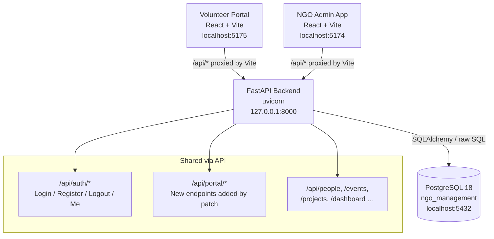
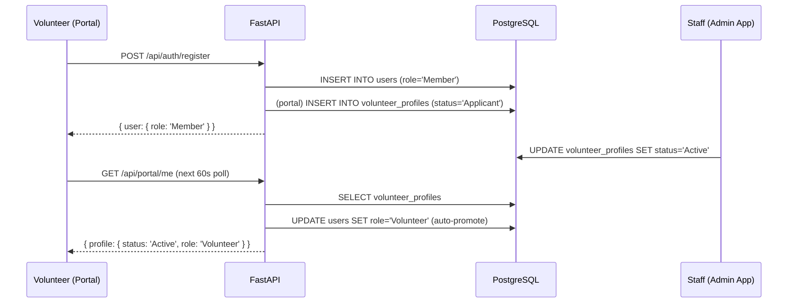
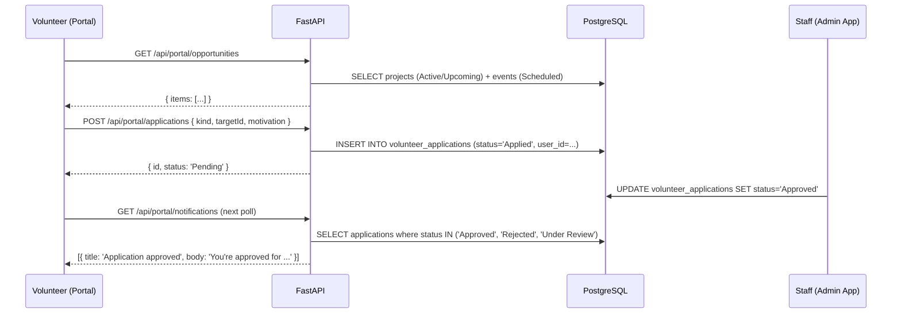

# Volunteer Portal — Detailed Technical Report

> [!NOTE]
> This report covers the **Hope Foundation Volunteer Portal** (`volunteer-portal`), its architecture, its integration with the **NGO Management System** (`NGO_Management_System_RBAC_final`), which database tables are shared, how data stays in sync, per-file responsibilities, and the known limitations.

---

## Table of Contents

1. [System Overview](#1-system-overview)
2. [Architecture Diagram](#2-architecture-diagram)
3. [How the Two Apps Connect](#3-how-the-two-apps-connect)
4. [Shared Database — Tables Used by the Portal](#4-shared-database--tables-used-by-the-portal)
5. [How Things Stay In Sync](#5-how-things-stay-in-sync)
6. [Frontend — File-by-File Breakdown](#6-frontend--file-by-file-breakdown)
7. [Backend Patch — File-by-File Breakdown](#7-backend-patch--file-by-file-breakdown)
8. [API Endpoints Reference](#8-api-endpoints-reference)
9. [Data Flow: Key User Journeys](#9-data-flow-key-user-journeys)
10. [Limitations](#10-limitations)

---

## 1. System Overview

The Volunteer Portal is a **self-service, volunteer-facing web app** built with React 19 + Vite + Tailwind CSS v4. It is **not a standalone system** — it deliberately shares the same PostgreSQL database, the same user accounts, the same authentication session, and the same projects/events data as the NGO Management System (the admin app used by staff).

| | Volunteer Portal | NGO Management System |
|---|---|---|
| **Users** | Volunteers, Members | Admin, Staff, Project Manager, Board |
| **Port** | 5175 | 5174 |
| **Backend** | Shared FastAPI at :8000 | Same FastAPI at :8000 |
| **Database** | `ngo_management` (PostgreSQL) | Same `ngo_management` |
| **Auth** | Cookie `ngo_session` (shared) | Same cookie |
| **Tech** | React 19, Vite 8, Tailwind v4 | React (Vite), Tailwind |

---

## 2. Architecture Diagram



---

## 3. How the Two Apps Connect

### 3.1 The Vite Proxy (zero CORS issues in dev)

[`vite.config.ts`](file:///c:/Users/pvhat/OneDrive/Desktop/volunteer-portal/vite.config.ts) configures a **reverse proxy**:

```ts
proxy: { '/api': { target: 'http://127.0.0.1:8000', changeOrigin: false } }
```

Every `fetch('/api/...')` call from the React app is transparently forwarded by Vite's dev server to the FastAPI backend. The browser never sees a cross-origin request, so cookies (`ngo_session`) flow naturally.

### 3.2 Cookie-Based Session (shared identity)

The backend sets a `ngo_session` JWT cookie on login. Both apps (ports 5174 and 5175) talk to the same backend (port 8000) so the **same cookie works for both**. A user logged into the admin app is already authenticated if they open the portal, and vice versa.

### 3.3 CORS for Production / External Clients

The patched [`config.py`](file:///C:/Users/pvhat/OneDrive/Desktop/NGO_Management_System_RBAC_final/ngo/backend/app/config.py) adds a `PORTAL_ORIGINS` setting (default: `http://localhost:5175,http://127.0.0.1:5175`) to the `ALLOWED_ORIGINS` set in [`main.py`](file:///C:/Users/pvhat/OneDrive/Desktop/NGO_Management_System_RBAC_final/ngo/backend/app/main.py). This enables the volunteer portal origin to pass CORS checks when it runs on a different port or domain.

### 3.4 Role Guard

`App.tsx` has a hard-coded `PORTAL_ROLES` array: `["Member", "Volunteer", "Admin", "Project Manager", "Staff"]`. After login, if the returned user's role is **not** in this list, the portal immediately calls `api.logout()` and shows the message:

> *"This portal is for volunteers. Please use the main Hope Foundation system."*

Every backend `/api/portal/*` route also runs `_guard(user)` which checks the same set, so protection is enforced both client-side and server-side.

---

## 4. Shared Database — Tables Used by the Portal

The portal reads from and writes to the **same** PostgreSQL tables as the admin app. No separate database or schema is used.

| Table | What the portal reads | What the portal writes |
|---|---|---|
| `users` | `id`, `full_name`, `email`, `role` (via auth session) | `full_name` (when profile name is changed), `role` (auto-promoted Member → Volunteer) |
| `user_sessions` | Validates the `ngo_session` JWT cookie | New row on login, deleted on logout |
| `volunteer_profiles` | `full_name`, `email`, `phone`, `city`, `about`, `skills`, `unavailable_days`, `status`, `joined_on` | Creates row on first login; updates `phone`, `city`, `about`, `skills`, `unavailable_days` |
| `volunteer_applications` | All applications for this user (by `user_id` or email match) | Inserts new application row; deletes (withdraws) pending ones |
| `volunteer_assignments` | All assignments where `volunteer_id` matches the volunteer profile | Read-only; staff write these in the admin app |
| `volunteer_attendance` | Hours, dates, status per attendance record | Read-only; staff write these in the admin app |
| `projects` | Active/Upcoming projects (name, sector, geography, dates, manager, status) | Read-only |
| `events` | Scheduled future events (title, type, location, capacity, dates, organizer) | Read-only |

### New Columns Added by Migration `0005_volunteer_portal.py`

| Table | Column(s) Added | Purpose |
|---|---|---|
| `volunteer_applications` | `user_id` (FK → users) | Links an application to a portal login account |
| `volunteer_applications` | `target_kind` (`General`/`Project`/`Event`) | What kind of opportunity was applied for |
| `volunteer_applications` | `target_id` (uuid) | ID of the specific project or event |
| `volunteer_applications` | `target_label` (text) | Display name of the opportunity (denormalised for speed) |
| `volunteer_profiles` | `about` (text) | Free-text bio, editable from the portal |
| `volunteer_profiles` | `unavailable_days` (text[]) | Days of the week the volunteer is unavailable |

---

## 5. How Things Stay In Sync

### 5.1 Real-Time (on every page load + every 60 seconds)

When the portal loads, `PortalProvider` fires **six parallel API calls** (`Promise.all`):

```
api.portalMe()        → profile + stats
api.opportunities()   → live projects & events from DB
api.applications()    → this user's application rows
api.assignments()     → this user's assignment rows
api.contributions()   → volunteer_attendance rows
api.notifications()   → derived from recent DB status changes
```

`portal.tsx` also sets a `setInterval` to re-call `reload()` every **60 seconds**, so the portal auto-refreshes without a page reload.

### 5.2 Staff Actions Immediately Visible to Volunteers

| Staff does this in Admin App | Volunteer sees this in Portal |
|---|---|
| Changes application status to "Under Review" or "Approved"/"Rejected" | Application card status updates on next reload; notification appears |
| Creates a `volunteer_assignment` row for the volunteer | Assignment appears in My Assignments; "Up Next" on Dashboard |
| Logs attendance (`volunteer_attendance`) | Hours/days update on Dashboard stats and Contributions page |
| Promotes profile status to "Active" | Portal auto-promotes user's `role` from `Member` to `Volunteer` via `_sync_role()` |
| Adds a project or event (status Active/Scheduled) | Appears in Opportunities list |
| Archives a project or cancels an event | Disappears from Opportunities |

### 5.3 Volunteer Actions Immediately Visible to Staff

| Volunteer does this in Portal | Staff sees this in Admin App |
|---|---|
| Registers (creates account) | New user row + volunteer_profiles row created |
| Submits an application | New row in `volunteer_applications` table, visible in Applications tab |
| Withdraws an application (only while Pending) | Row deleted from `volunteer_applications` |
| Edits profile (name, phone, location, about, skills, availability) | `volunteer_profiles` row updated; `users.full_name` updated |

### 5.4 Profile Auto-Save

Skills and availability day changes trigger a **1200ms debounced auto-save** (no button press needed). Name, phone, location, and about require clicking "Save profile" or "Save changes". Both paths call `api.updateProfile()` → `PATCH /api/portal/me`.

---

## 6. Frontend — File-by-File Breakdown

### `src/main.tsx`
React entrypoint. Creates the React root, wraps everything in `React.StrictMode`, and mounts `App`. Imports `index.css` to load Tailwind.

---

### `src/App.tsx`
**Root component and authentication controller.**

- On mount, calls `api.me()` to check if a session cookie already exists (auto-login on refresh).
- Maintains `user` state (`AuthUser | null`).
- Exports `login()`, `register()`, `logout()` functions that call the API and update state.
- Role guard: after login, checks `PORTAL_ROLES`; blocks non-volunteer accounts.
- Registration also calls `api.updateProfile()` immediately after to save phone and location (which `/api/auth/register` doesn't accept directly).
- Renders either `AuthPage` (unauthenticated) or `AppShell` wrapped in `PortalProvider` (authenticated).
- On logout: calls `api.logout()`, clears two `localStorage` keys (`volunteer-portal-demo-v1`, `volunteer-portal-read-notifications`).

---

### `src/api.ts`
**All communication with the backend — the single source of truth for API calls.**

- `request<T>()`: base fetch wrapper that prepends `/api`, sends `credentials: 'include'` (for the session cookie), handles non-OK responses, parses error detail from JSON body.
- `ApiError`: custom error class with an HTTP `status` code.
- **Type exports**: `AuthUser`, `Profile`, `Stats`, `Me`, `Opportunity`, `Application`, `Assignment`, `Contributions`, `PortalNotification` — TypeScript shapes of every API response.
- **`api` object** — all endpoints:
  - `me()` → `GET /api/auth/me` — check current session
  - `login()` → `POST /api/auth/login`
  - `register()` → `POST /api/auth/register`
  - `logout()` → `POST /api/auth/logout`
  - `portalMe()` → `GET /api/portal/me` — full profile + stats
  - `updateProfile()` → `PATCH /api/portal/me`
  - `opportunities()` → `GET /api/portal/opportunities?kind=all|project|event`
  - `opportunity()` → `GET /api/portal/opportunities/{kind}/{id}`
  - `apply()` → `POST /api/portal/applications`
  - `applications()` → `GET /api/portal/applications`
  - `withdraw()` → `DELETE /api/portal/applications/{id}`
  - `assignments()` → `GET /api/portal/assignments`
  - `contributions()` → `GET /api/portal/contributions`
  - `notifications()` → `GET /api/portal/notifications`
- **Utility functions**: `fmtDate()`, `fmtTime()`, `ago()`, `tones`, `toneFor()` — date/time formatting and status → colour tone mapping.

---

### `src/index.css`
Global CSS. Contains `@import 'tailwindcss'` (Tailwind v4 entry point), all component-level CSS rules (`.page`, `.panel`, `.btn`, `.sidebar`, `.topbar`, `.auth-page`, etc.), CSS custom properties for the design system (colours, radii, shadows), and font defaults. No separate Tailwind config is needed.

---

### `src/components/portal.tsx`
**Global data context — the "state manager" for all live backend data.**

- `PortalProvider`: fetches all six data types on mount via `Promise.all`, stores them in React state.
- Polls the backend every 60 seconds via `setInterval`.
- If a `401` is returned, calls `logout()` automatically (session expired).
- `saveProfile()`: diffs the current profile against the last-synced snapshot. Only calls `PATCH /api/portal/me` if something actually changed.
- Debounced auto-save: skills and `unavailableDays` changes trigger a 1200ms timer to call `saveProfile()`.
- `usePortal()` hook: gives any child component access to `me`, `opportunities`, `applications`, `assignments`, `contributions`, `notifications`, `readIds`, `markRead`, `reload`, `selected`, `select`, `selectedApplicationId`, `selectedAssignmentId`, `saveProfile`.

---

### `src/components/demoStore.tsx`
**Local-only state (stored in `localStorage`) for features not yet backed by the API.**

Manages: community posts, likes, connections, notification read flags, notification preferences, privacy preferences, and the local copy of the profile (used as an edit buffer before saving).

- `DemoStoreProvider`: reads from `localStorage` on mount (key: `volunteer-portal-demo-v1`), writes to it on every state change.
- When `PortalProvider` loads live data from the server, it calls `setData()` from `useDemoStore()` to overwrite the local profile fields with the authoritative backend values. This is the bridge between the two stores.
- `suggestedPeople`: a hardcoded list of fictional volunteer profiles used on the Networking page.

> [!IMPORTANT]
> `demoStore` is **not synced to the backend**. Posts, likes, connections, notification preferences, and privacy preferences exist only in the browser's `localStorage`. They are lost when the user clears storage or switches browsers.

---

### `src/components/layout.tsx`
**The app chrome — sidebar, topbar, and page router.**

- `Sidebar`: navigation menu. Reads `me.stats.hours` from `usePortal()` to show the "hours of impact" mini-badge. Highlights the active page.
- `Topbar`: breadcrumb, global search input (pressing Enter navigates to Projects), notification bell (popover showing latest 3 notifications with unread count badge), profile avatar button.
- `AppShell`: owns the `page` state (a string union type `Page`). Renders the correct page component via a `switch`. No routing library is used — navigation is purely state-based.

---

### `src/components/shared.tsx`
**All reusable UI primitives and static data.**

Contains: `Avatar`, `Button`, `Icon`, `Logo`, `Status`, `StatCard`, `OpportunityCard`, `SectionTitle`, `PageHeader`, `Detail`, `Toggle`, `FilterBar`, `AuthField`, `NotificationItem` components. Also exports:
- `nav`: the sidebar navigation item definitions (id, label, icon).
- `pageTitles`: map of page id → display title.
- `cardFor()`: converts an `Opportunity` API object into the shape that `OpportunityCard` expects.
- `apps`, `people`, `photos`: static demo/seed data used by `demoStore` and `NetworkingPage`.

---

### `src/pages/AuthPage.tsx`
Login, registration, and "forgot password" views. Three sub-views controlled by a local `view` state. Registration collects: full name, phone, email, location, password, confirm password. Calls `onLogin` or `onRegister` props (defined in `App.tsx`). Password reset shows a static message telling the user to contact an admin (no self-service reset endpoint exists in the backend).

---

### `src/pages/DashboardPage.tsx`
**Landing page after login.** Shows:
- Welcome card with today's date and first name from `me.profile.fullName`.
- "Up Next" panel: the next non-completed assignment (date tile, title, location/time).
- Stats grid: upcoming assignments, active applications, current assignments, volunteer hours — all live from `me.stats`.
- Two opportunity cards (first two from `opportunities` list).
- Three most recent applications (mini list).
- Impact ring showing total hours.
- Community callout linking to Networking.

---

### `src/pages/ProjectsPage.tsx`
Lists all opportunities. Accepts a `events` prop to filter by kind (events vs projects). Supports text search (via `searchQuery` prop from `AppShell`), location filter, and skill filter — all client-side filtering of the already-fetched `opportunities` array. Each card has a "View details" button that sets `selected` in `PortalContext` and navigates to `project-detail`.

---

### `src/pages/ProjectDetailPage.tsx`
Detail view for a single project or event. Fetches the specific opportunity via `api.opportunity(kind, id)` (not just from cache, to get `myApplication` field). Shows full description, type, location, dates, organiser, capacity/registered count. Has an "Apply" button that calls `api.apply()` and refreshes data. Handles duplicate-application (409) error gracefully.

---

### `src/pages/ApplicationsPage.tsx`
Lists all the logged-in user's applications (from `applications` in context). Shows status badge, application date. Clicking a row sets `selectedApplicationId` and navigates to `application-detail`.

---

### `src/pages/ApplicationDetailPage.tsx`
Detail view for a single application. Reads the selected application from `applications` array by `selectedApplicationId`. Shows: target name/type, status, applied date, last updated, motivation text. "Withdraw" button calls `api.withdraw(id)` — only enabled if status is Pending.

---

### `src/pages/AssignmentsPage.tsx`
Lists assignments grouped into "Current", "Upcoming", and "Completed" sections (grouping done by the backend). Clicking a row sets `selectedAssignmentId` and navigates to `assignment-detail`.

---

### `src/pages/AssignmentDetailPage.tsx`
Detail view for a single assignment. Reads from `assignments` array by `selectedAssignmentId`. Shows: title, role, responsibilities, start/end date, location, status, contact name and email.

---

### `src/pages/ContributionsPage.tsx`
Shows the volunteer's contribution history from `contributions` context:
- Monthly hours bar chart (last 6 months, rendered as a simple CSS bar visualization).
- Breakdown by kind (Project vs Event).
- Detailed log table of every attendance record (date, name, role, hours, status).

All data comes from `volunteer_attendance` table via the backend.

---

### `src/pages/NotificationsPage.tsx`
Lists all notifications from `notifications` context. Calls `markRead()` on all IDs when the page is visited. Read IDs are stored in `localStorage` (key: `volunteer-portal-read-notifications`). Notifications are **derived** by the backend (not a real notification table) — see API section below.

---

### `src/pages/PostsPage.tsx`
Community feed. **Entirely local (demoStore)**. Posts, likes, and comments are stored in `localStorage` only. No backend API is involved. Pre-seeded with two example posts (Neha Joshi, Ravi Kumar).

---

### `src/pages/NetworkingPage.tsx`
Volunteer discovery. **Entirely local (demoStore)**. Displays `suggestedPeople` (hardcoded in `shared.tsx`). Connections are stored in `localStorage`. Supports text search, location filter, and skill filter — all client-side.

---

### `src/pages/SettingsPage.tsx`
Four tabs: Account, Security, Notifications, Privacy.
- **Account**: edits name, phone, location — saved via `saveProfile()` → `PATCH /api/portal/me`.
- **Security**: static message directing to admin for password reset.
- **Notifications**: toggles stored in `demoStore` (localStorage only).
- **Privacy**: toggles stored in `demoStore` (localStorage only).

---

## 7. Backend Patch — File-by-File Breakdown

### `backend-patch/app/api/portal.py` → copied to `ngo/backend/app/api/portal.py`

The entire new API surface for the volunteer portal. A FastAPI `APIRouter` with prefix `/api/portal`.

| Function | Method + Path | Description |
|---|---|---|
| `me()` | `GET /api/portal/me` | Returns `{ profile, stats }`. Finds or creates the volunteer profile. Auto-promotes Member → Volunteer if profile is Active. |
| `update_me()` | `PATCH /api/portal/me` | Updates `volunteer_profiles` and optionally `users.full_name`. |
| `opportunities()` | `GET /api/portal/opportunities` | Returns live projects (Active/Upcoming) and/or events (Scheduled, not in the past). |
| `opportunity()` | `GET /api/portal/opportunities/{kind}/{id}` | Single opportunity card + the user's existing application if any. |
| `apply()` | `POST /api/portal/applications` | Creates a `volunteer_applications` row. Checks for duplicates (409 if already applied). |
| `applications()` | `GET /api/portal/applications` | Lists all applications for this user (by `user_id` OR email match for pre-portal records). |
| `withdraw()` | `DELETE /api/portal/applications/{id}` | Deletes only if status is `New` or `Applied`. |
| `assignments()` | `GET /api/portal/assignments` | Joins `volunteer_assignments` with `projects` and `events`. Groups as Current/Upcoming/Completed. |
| `contributions()` | `GET /api/portal/contributions` | Reads `volunteer_attendance`. Returns item list, monthly totals, and kind breakdown. |
| `notifications()` | `GET /api/portal/notifications` | Derived from application status changes, new assignments, and attendance records. No separate notification table. |

**Key internal helpers:**

- `_guard(user)`: checks role is in `PORTAL_ROLES`, raises 403 if not.
- `_profile(db, user, create)`: finds volunteer profile by `user_id`, falls back to email match (handles staff-created profiles), optionally creates one on first login.
- `_sync_role(db, user, profile)`: if `profile.status == "Active"` and `user.role == "Member"`, upgrades the user's role to `"Volunteer"` automatically.
- `_profile_json(p, user)`: serialises a profile DB row to the API JSON shape, camelCasing field names.

---

### `backend-patch/app/config.py` → replaces `ngo/backend/app/config.py`

Adds one new field to the Pydantic settings model:

```python
portal_origins: str = "http://localhost:5175,http://127.0.0.1:5175"
```

This is consumed by `main.py` to build the CORS `ALLOWED_ORIGINS` set.

---

### `backend-patch/app/main.py` → replaces `ngo/backend/app/main.py`

Two changes from the original:

1. **Imports and registers** `portal_router`:
   ```python
   from app.api.portal import router as portal_router
   ...
   app.include_router(portal_router)
   ```

2. **Expands CORS origins** to include portal origins:
   ```python
   ALLOWED_ORIGINS = {settings.app_origin, *[o.strip() for o in settings.portal_origins.split(",") if o.strip()]}
   ```
   Also adds the `localhost` ↔ `127.0.0.1` swap for development convenience.

---

### `backend-patch/alembic/versions/0005_volunteer_portal.py` → copied to `ngo/backend/alembic/versions/`

Database migration that adds the new columns needed by the portal (described in Section 4 above). Chain: `0004_proposals_events` → `0005_volunteer_portal`. Uses `IF NOT EXISTS` so it is safe to run multiple times.

---

## 8. API Endpoints Reference

### Auth endpoints (existing, unchanged)

| Method | Path | Used by Portal |
|---|---|---|
| `POST` | `/api/auth/login` | Yes — login |
| `POST` | `/api/auth/register` | Yes — registration |
| `POST` | `/api/auth/logout` | Yes — logout |
| `GET` | `/api/auth/me` | Yes — session check on app load |

### Portal endpoints (new)

| Method | Path | Description |
|---|---|---|
| `GET` | `/api/portal/me` | Profile + stats |
| `PATCH` | `/api/portal/me` | Update profile |
| `GET` | `/api/portal/opportunities` | List open opportunities |
| `GET` | `/api/portal/opportunities/{kind}/{id}` | Single opportunity |
| `POST` | `/api/portal/applications` | Apply |
| `GET` | `/api/portal/applications` | My applications |
| `DELETE` | `/api/portal/applications/{id}` | Withdraw |
| `GET` | `/api/portal/assignments` | My assignments |
| `GET` | `/api/portal/contributions` | My contributions + hours |
| `GET` | `/api/portal/notifications` | Derived notifications |

All portal endpoints require an active `ngo_session` cookie and the user's role must be in `PORTAL_ROLES`.

---

## 9. Data Flow: Key User Journeys

### Registration → Approval → Active Status



### Applying for an Opportunity



---

## 10. Limitations

> [!WARNING]
> The following features are **not backed by the database**. They are local-only and will be lost if the user clears browser storage or logs in from a different browser/device.

### Local-Only (Not Synced to Backend)

| Feature | Where it lives | Impact |
|---|---|---|
| **Community Posts** | `localStorage` via `demoStore` | Posts visible only to the author; not shared across users |
| **Post Likes & Comments** | `localStorage` | Likes are per-browser only |
| **Networking Connections** | `localStorage` | Connections are local; not stored in DB |
| **Suggested People** | Hardcoded in `shared.tsx` | Static fictional data, not real volunteers from DB |
| **Notification Preferences** | `localStorage` | Toggles don't actually filter backend notifications |
| **Privacy Preferences** | `localStorage` | "Show profile in search" doesn't affect networking visibility |
| **Avatar Photo** | `localStorage` (base64) | Profile photo is local-only; not uploaded to server |

### No Self-Service Password Reset

The "Forgot password?" flow shows a static message. The backend has no password-reset endpoint; an administrator must do it manually in the admin app.

### Notifications are Derived, Not Pushed

`GET /api/portal/notifications` is computed on every request by querying application and assignment tables. There is no WebSocket, no push notification, and no dedicated notifications table. Unread state is tracked in `localStorage` only.

### No Pagination

All API endpoints return complete result sets with no pagination. For users with many applications or attendance records, response size could grow large. `contributions` is capped at 200 rows client-side.

### Staff Roles Cannot Use the Portal to Apply

The role guard (`_guard`) allows `Admin`, `Project Manager`, and `Staff` to access the portal to *view* it, but `apply()` (POST `/api/portal/applications`) additionally checks `user.role not in {"Member", "Volunteer"}` and returns 403 for staff accounts.

### No Email Notifications

There is no email-sending integration. Volunteers must actively check the portal (or wait for the 60-second auto-poll) to see status changes.

### Running Both Apps for Development

Two separate processes must be started manually:
1. **Backend**: `uvicorn app.main:app --host 127.0.0.1 --port 8000` (in `ngo/backend/`)
2. **Volunteer Portal**: `pnpm run dev` (in `volunteer-portal/`)
3. **NGO Admin App**: `npm run dev` (in `ngo/frontend/`)

There is no single command to start all three together (the NGO `start.py` only starts the admin app + backend, not the volunteer portal).
